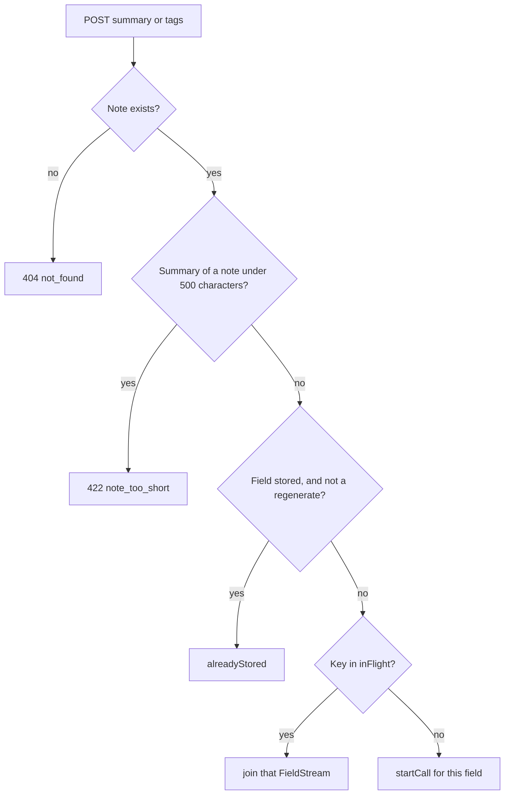
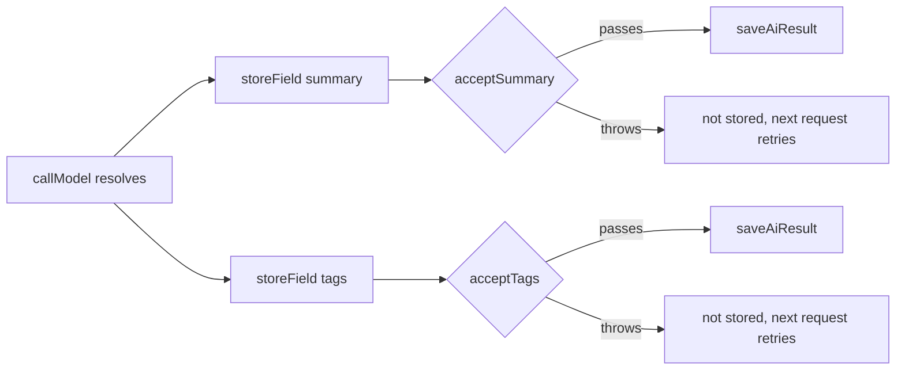

# How enrichment works

`server/src/notes/enrichment.ts` owns every model call. The rules a result must pass live next to it, in `ai-output.ts`, as pure functions. The [design overview](../README.md#design) is the same feature from the HTTP side.

## Words

| Word | Is | In the code |
| --- | --- | --- |
| call | One model request for one or both fields of a note. | `startCall`, `callModel` |
| output | What the model returned, parsed but not yet checked. | `SummaryOutput`, `TagsOutput` |
| preview | One field as the model is still writing it. Not checked, never stored. | `AiPreview`, `createPreviewFeed`, `parsePartialField` |
| result | One field as the row stores it. | `AiResult` |
| field stream | What a request for one field reads: previews, then the result. | `FieldStream { watch, result }` |

## State

One enricher exists per API process. Its only long-lived structure is `inFlight`: a map from `summary:<note id>` or `tags:<note id>` to that field's `FieldStream`, for as long as a call is writing it. A call for both fields of a long note lists two streams, one under each key. Each key is removed when its field's `result` settles, stored or failed.

A second API process has its own empty `inFlight` and can't see these keys. The conditional write in `repo.saveAiResult` (`UPDATE … WHERE <column> IS NULL`) is what makes two processes agree on one stored value.

## Where a request enters

`POST /api/notes/:id/summary` and `/tags` call `enrichField`, which takes the first step that applies:

`?regenerate=true` skips the stored value but still joins a running call: the model is already writing a new result.

`enrichNote` makes the same per-field decision (`existingStream`) for every field a note gets: tags, plus the summary from 500 characters up. It skips a field that is stored (unless regenerating) or already being written, and starts one call for the rest, so it is safe to run again on a saved note. `POST /api/notes` calls it right after the insert, when nothing is stored or running, so a long note gets both fields from one call. It takes the note rather than its id, so the call is listed in `inFlight` before the create request responds. It logs the failures of the call it started, because no request may be reading it.

## One call

`startCall` makes one `PreviewFeed` per field, then `callModel`:

1. **Re-read the note.** It may have been deleted (→ 404), or a call that ended meanwhile may have stored every field (→ no output, nothing asked).
2. **Ask the provider.** `summarizeAndTag` when both fields are wanted, so the note's tokens are paid once; otherwise `summarize` or `generateTags`.

While the model writes, every text delta goes to every feed. Each feed appends it, parses its own field with `parsePartialField`, and calls its listeners only when the preview changed. A listener is a streaming HTTP response, added by `watch`. `watch` first sends the latest preview, so a request that joins halfway sees the field so far.

When the call resolves, each field's `storeField` runs on its own:

A summary that breaks its rule doesn't cost the tags. Without `regenerate`, `saveAiResult` writes only an empty column, so the first writer wins and a later one gets the stored value back. With `regenerate`, it replaces the column. No row back means the note was deleted while the model wrote, which is a 404.

## Shutdown

`idle()` waits until `inFlight` is empty. `index.ts` calls it after the server stops accepting connections, so a new note's call can store its result before the pool closes.
